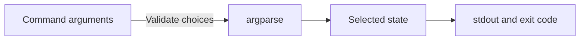

# Understand the status fixture

This view explains argument handling and results in one Python process. The
[implementation](../../tools/status.py) is the authoritative source.

The value is supplied by the caller or its default. It is not evidence about a
running service. Argument errors exit before a state is printed. Exact values
belong to the [command reference](../reference/command.md).

From this example's root, run `python3 tools/status.py` and
`python3 tools/status.py --state busy` to check both results. The template's tests
also exercise an invalid value and verify stdout, stderr, and exit codes.

[Documentation index](../README.md)
